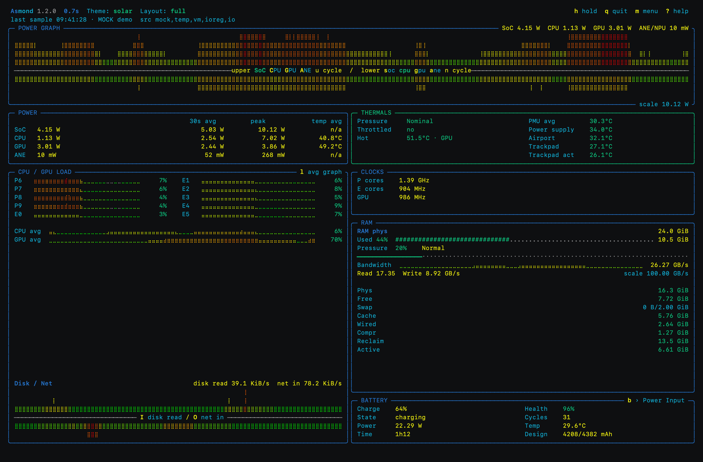
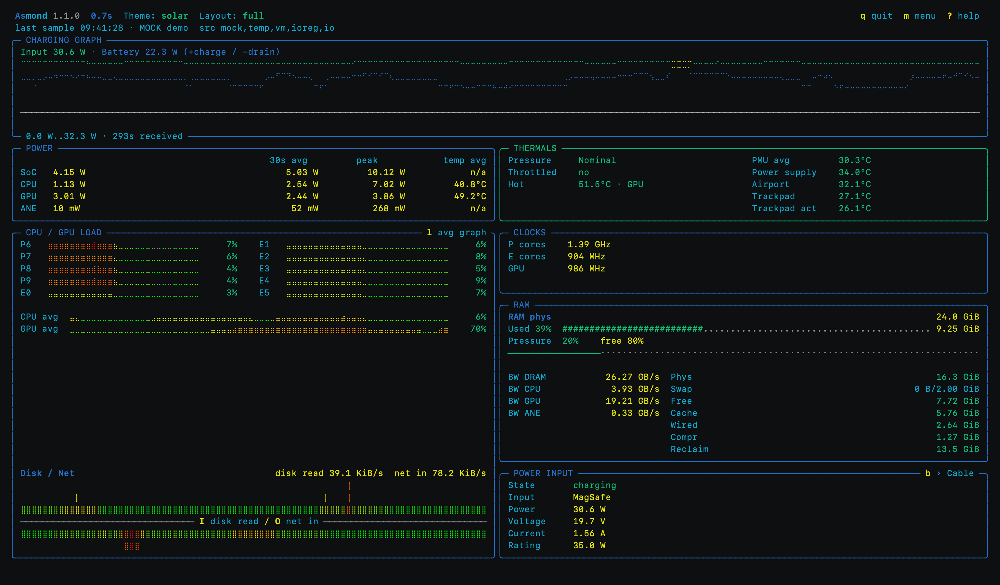
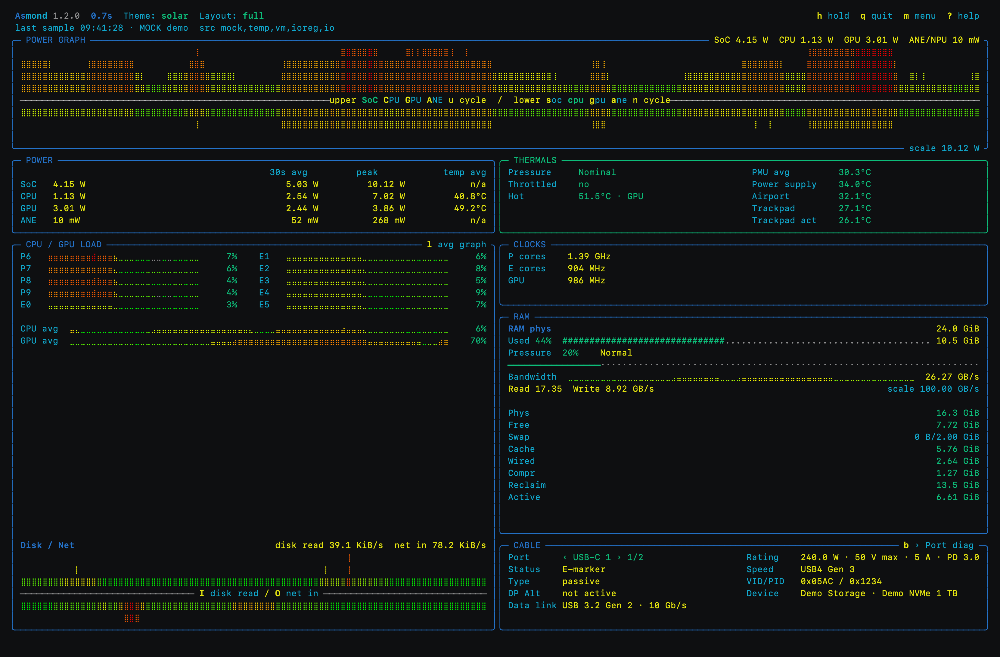
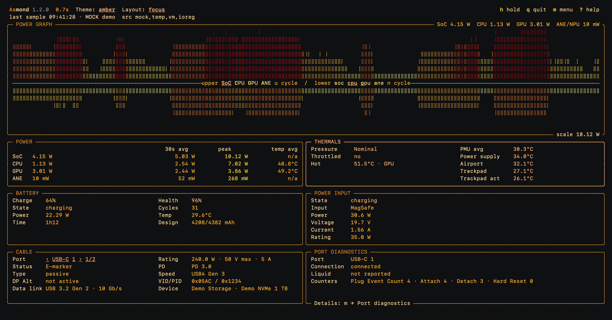
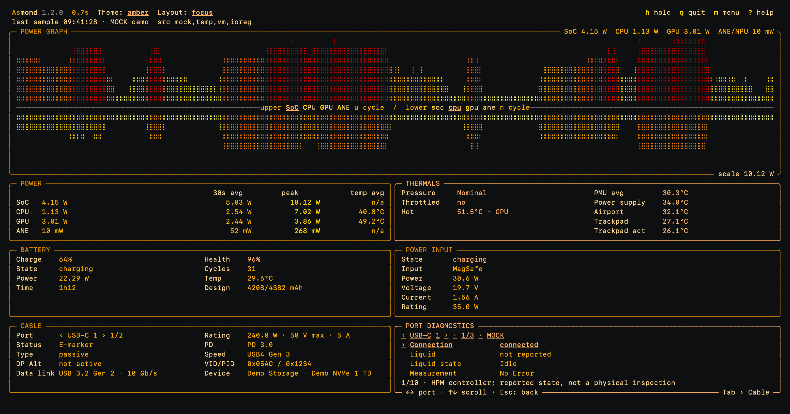
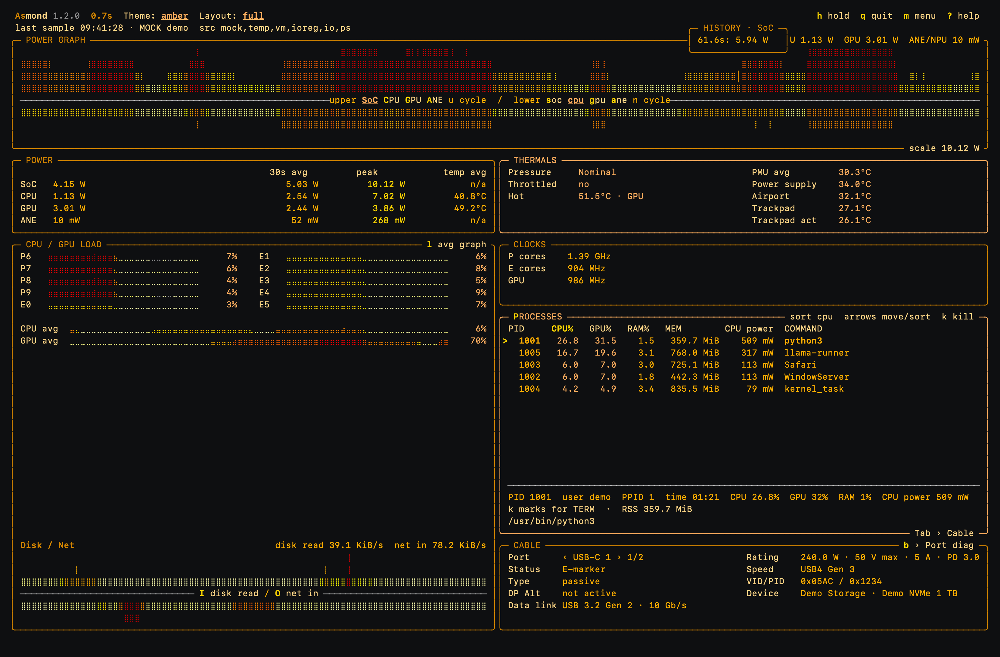

# Asmond

Current release: 1.1.0.

Development checkout: 1.1.0-dev.

Asmond is a macOS power, thermal and activity monitor for Apple Silicon and Intel Macs.

It reads Apple's `powermetrics` plist stream and combines it with macOS system counters for memory, swap, battery, disk, network and process data. The project is intentionally small: a compact Python runtime, focused regression tests, and no third-party Python package dependencies.

## Preview



*Preview from 1.1.0 in the Solar theme with generated mock telemetry. Workload history includes irregular activity, idle phases and short bursts; these demonstration values are not hardware measurements.*

<details>
<summary>Full layout with charging graph and Power Input</summary>



</details>

<details>
<summary>Full layout with Cable details</summary>



</details>



*Focus in Amber with its optional Port diagnostics overview beside Battery, Power Input and Cable.*

<details>
<summary>Focus with active, scrollable Port diagnostics</summary>



</details>

<details>
<summary>Historical graph values and keyboard focus in Amber</summary>



*Hover selects one stored measurement near the plotted graph. Tab moves between the process table and multi-port Cable; the muted focus hint appears only when a switch is useful.*

</details>

## Features

- SoC or Intel package, CPU, GPU and ANE/NPU power, plus Intel RAM power where verified counters expose it
- Graph hover for individual stored measurements, with bounded 5/10/30-minute in-memory history independent of terminal width
- Tab/Shift-Tab focus navigation between visible interactive panels, with scoped process/port actions and subtle conditional hints
- Shared-scale split power graph with independently selectable upper and lower sources and an 11-step green-to-red terminal gradient where supported
- Current, 30 second average and peak values for power readings, followed by verified CPU/GPU average temperatures where available
- Thermal pressure, throttling state, hottest verified sensor with source, and additional physical sensor temperatures where available
- P-core/E-core usage rows, CPU/GPU average rows and an alternate CPU/GPU graph view
- P-core/E-core and GPU clocks, with live smoothing for idle `0 Hz` cluster samples; missing or invalid readings clear the affected idle-clock cache
- RAM, swap and memory pressure using `vm_stat`, `vm.swapusage` and `memory_pressure`
- Legacy memory bandwidth counters in the RAM panel when `powermetrics` exposes `bandwidth_counters`
- Battery details in a compact two-column view: charge, state, health, capacity, cycle count, power, temperature and time remaining
- Power-input details from IOKit: USB-C/MagSafe active port, negotiated voltage/current/power and PD profiles when exposed
- Dependency-free USB-C cable view from real SOP'/SOP'' E-marker VDOs: type, current/voltage/power rating, data class, VID/PID and PD revision, plus the current data link and DP Alt Mode state from the matching port
- Optional compact disk/network I/O graph with selectable read/write sources
- Optional process panel with PID, CPU%, RAM%, RSS, CPU power and GPU% where usable counters are available
- Layout presets: `full`, `compact`, `focus`, plus named custom profiles with selectable grids and independent panel assignments
- Alerts for throttling, high temperature, swap usage and battery drain
- Optional rounded Unicode panel borders, with square curses borders when disabled or unsupported
- Theme-colored ASCII logo on the waiting screen, help overlay and settings menu
- Local persistence for theme, interval, layout, custom slots, graph sources, process panel and alert thresholds
- `doctor` and anonymized `report` commands for troubleshooting
- Read-only measurement/source inspector in the settings menu, using existing worker data without extra probes

On verified hardware, Asmond supports CPU core temperature average/maximum,
iGPU die, CPU PECI/proximity, RAM proximity, PCH and AirPort temperatures on the
Macmini8,1 with i5-8500B. Other Intel sensor maps remain unavailable until
verified; physical core sensor names are not guessed into logical CPU IDs.
Intel GPU load/frequency now select the identifiable integrated GPU, preventing
mixing a discrete GPU's readings with integrated-GPU power.

On Intel desktops without HPM telemetry, Cable and Port diagnostics can use
explicit XHCI Type-C identities, direct USB3 device links and reported counters.
This path supplies no charge-input, E-marker, DisplayPort or liquid-detection
claim. A missing USB3 child does not prove a physical disconnect: the USB2
companion may be active. Counter lifetime/reset scope remains unspecified.

On both Intel and Apple Silicon, Cable also shows the directly attached USB
device's reported identity. Storage devices can include the enclosure maker,
drive model and physical capacity in decimal units. These are device details,
separate from cable E-marker ratings; no NVMe protocol, hub-child identity,
partition capacity or RAID total is inferred. Missing details are hidden.
The full fields remain available in Data sources and reports. Additional
metadata refreshes independently every five seconds and expires after fifteen
seconds, so it does not hold up the fast charge/connection updates.
The Cable view puts Port first, combines cable current/PD with Rating when
space permits, and groups the cable IDs as VID/PID. A capacity already stated
in the displayed model is not repeated when it matches the measured size at
display precision; the report still includes the measured byte count.

An internal Intel NVMe SSD can also supply its SMART composite temperature
through Apple's read-only native interface, without `smartctl` or extra Python
packages. Only one explicitly internal, SMART-capable device is accepted;
external/ambiguous devices and unsupported SATA paths stay unavailable. The
native temperature has one-Kelvin resolution, is converted to Celsius, and is
refreshed every ten seconds in an independent worker (expires after 30 seconds).
An observed dashboard/recording clock gap also clears this cache and rejects
results from a read started before that gap, including after system sleep.
It is shown separately as SSD temperature, not substituted for a CPU sensor.

## Hardware validation coverage

This table summarizes capabilities confirmed in real captures or target-side
comparisons on specific machines and macOS versions. **Confirmed** refers to
the named reading or behavior in those checks; it does not imply that every
operating state or release was tested. **Unassigned** means readable data
without a verified sensor identity. **Not observed** means the feature was not
seen in those checks, not that the hardware necessarily lacks it. Patched macOS
installations count as tested configurations and are identified explicitly.

| Hardware / tested macOS | Power and activity | Temperatures / fans | Battery / input | Cable / link |
| --- | --- | --- | --- | --- |
| MacBook Air, base M4 4P+6E / 27.0–27.0.1 | CPU/GPU/ANE power, core load and clocks confirmed | CPU/GPU and auxiliary temperatures confirmed; fanless model | Battery and MagSafe confirmed | E-marker and USB link confirmed |
| Mac14,5, M2 Max 8P+4E / 27.0.1, 27.2.1 | Power/load confirmed | Two fan RPM readings, five GPU-cluster temperatures and power-supply/AirPort/trackpad temperatures confirmed; CPU average/maximum confirmed only with a complete valid twelve-sensor group; individual CPU temperature labels unassigned | Battery/charging confirmed | E-marker, USB link and active DP confirmed |
| Macmini8,1, Intel i5-8500B / 15.6 | Package/CPU/iGPU power and load confirmed | CPU core and iGPU die temperatures, fan RPM and internal NVMe SMART temperature confirmed | No internal battery; charge telemetry not observed | Four direct USB-C links at 10 Gb/s confirmed; E-marker data unavailable in captures |
| MacBookAir7,1, Intel i5-5250U / 11.7.11 | Package/CPU/iGPU/DRAM power and load confirmed | CPU-die temperature and one fan RPM reading confirmed | Battery and adapter transitions confirmed; connector identity unavailable | Cable identity not observed |
| MacBookAir7,2, Intel i5-5350U / 13.7.8, 14.8.1 (Legacy Patcher)* | Package/CPU/iGPU/DRAM power and load confirmed | CPU-die temperature, one fan RPM reading and internal SSD temperature confirmed where available | Battery and adapter transitions confirmed; legacy MagSafe adapter data confirmed on 14.8.1 | No proven USB-C port identity on the 13.7.8 target |
| MacBookPro14,3, Intel i7-7920HQ / 13.7.8 | Package/CPU/iGPU/DRAM power and load confirmed | CPU/GPU die temperatures, two fan RPM readings and internal SSD temperature confirmed where available | Battery and adapter transitions confirmed; charge connector identity unavailable | Direct USB-C device identity, 10-Gb/s link and different-port reconnect confirmed; E-marker unavailable |

\* macOS 14.8.1 on MacBookAir7,2 was tested successfully with Legacy Patcher.
Recorded power and load readings, CPU temperature, fan RPM, battery and MagSafe
adapter data, and charger disconnect/reconnect checks confirm operation in that
configuration. This patched installation is part of the validation coverage.

Intel Macs are supported with the capability limits below; the four tested
models establish the current validation baseline. Additional laptop checks
cover a one-hour TUI run and sleep/wake recovery on MacBookAir7,2/macOS 13.7.8,
plus USB data-device removal and different-port reconnect in the same running
UI on MacBookPro14,3/macOS 13.7.8. These observations do not establish every
Intel model, controller or macOS version.

SoC/ANE temperature assignments remain unverified on the tested Apple Silicon
machines. Port-diagnostic fields are controller-dependent: missing liquid state
or error counters never establish a healthy port. See [Data Accuracy](#data-accuracy)
for source semantics and [the M2 comparison guide](docs/m2-max-comparison.md)
for the remaining temperature work. Generated mock values are not evidence for
any cell in this table.

Intel support includes clean sampler shutdown, recording/export and the tested
charger, sleep/wake and USB transitions described above. Detailed temperature
maps, internal NVMe SMART, charging-port identity, USB link/device information
and port diagnostics remain optional capabilities. Missing Intel E-marker,
DisplayPort or liquid-detection data is not inferred from a USB connection;
Intel process watts and unavailable GPU counters are not estimated. The
documented model/macOS combinations define the validation scope. In particular,
macOS 26 has not received a current native acceptance run.

## Requirements

- macOS on Apple Silicon or Intel
- Python 3.10 or newer
- `sudo` access for the live `powermetrics` sampler

Intel support covers the common CPU, memory, swap, disk/network, process and recording paths. Power, temperatures, fans, battery and USB details depend on the readings that each model and macOS version exposes; unavailable optional values do not imply an unsupported architecture. Use the hardware validation table above for observed combinations.

`requirements.txt` is intentionally empty of package requirements.

The live dashboard, `probe`, and `report --live` use `sudo` for Apple's `powermetrics` sampler. If ordinary termination is denied, cleanup may use the cached authorization noninteractively to signal only that exact, unreaped sampler child. The Asmond UI remains unprivileged. Generated mock data, `doctor`, and the default non-live `report` do not require `sudo`; `doctor --live` only uses an already cached credential and never prompts for a password.

## Installation

With Homebrew:

```bash
brew tap Fxxrz/asmond
brew install asmond
```

Update an existing Homebrew installation:

```bash
brew update
brew upgrade asmond
```

Run Asmond:

```bash
asmond
```

Or run directly from a source checkout:

```bash
git clone https://github.com/Fxxrz/asmond.git
cd asmond
python3 asmond.py
```

Asmond keeps the terminal UI unprivileged. Sampling and, when needed, cleanup of its own sampler use `sudo`; unrelated process actions never do. Trusted macOS tools are invoked through fixed system paths rather than the user's `PATH`.
Homebrew also installs the manual page, available as `man asmond`.

### Direct installer

A Homebrew-independent installer is available in `install.sh`. It detects macOS and native Intel/Apple Silicon, uses an existing Python 3.10+ with `ctypes` and `curses`, and can offer the signed, prebuilt Python.org installer if Python is missing. It never compiles Python or Asmond and never runs the whole installer as root.

The default locations are `~/.local/share/asmond` for versioned files and `~/.local/bin/asmond` for the start command; custom paths are supported. PATH setup is opt-in and may require opening a new login terminal. Homebrew's Cellar and existing foreign commands are not overwritten. Direct installs support `asmond --update`; Homebrew installs must continue using `brew upgrade asmond`.

Run the installer from the pinned release tag:

```sh
curl --fail --silent --show-error --location --proto '=https' --proto-redir '=https' \
  https://raw.githubusercontent.com/Fxxrz/asmond/v1.1.0/install.sh | /bin/bash
```

Download and inspect the script before running it if preferred. The installer verifies the official release archive and checksum before activation. See [Direct installation](docs/direct-install.md) for custom paths, updates and rollback. Direct-install assets are available starting with 0.9.0; use 0.9.1 or later for working interactive confirmations. Older releases are not substituted with unchecked source downloads.

## Usage

The examples below use the installed `asmond` command. From a source checkout, replace `asmond` with `python3 asmond.py`.

Run the dashboard:

```bash
asmond
```

Run with generated demo data:

```bash
asmond --mock
```

The demo uses unequal task phases, idle periods, short bursts and lagging
temperatures instead of repeating sine/cosine curves. CPU, GPU, memory, I/O,
processes and charging share a deterministic time-based profile; the charging
example keeps battery power below input after component and other system power.
All these values are synthetic and do not validate the host's hardware support.

Show one parsed sample:

```bash
asmond probe
```

Inspect raw flattened `powermetrics` keys and values:

```bash
asmond probe --raw
```

`probe --raw` is not anonymized. Prefer `asmond report` for public bug reports.

Check local data sources without starting the TUI:

```bash
asmond doctor
asmond doctor --json
asmond doctor --live
```

`doctor --live` checks one real sample only when the current `sudo` credential is already cached; it does not prompt.

Create an anonymized support report. Connected USB device names and free-form
descriptors are omitted. Port link details and reported drive capacity remain
available for troubleshooting.

```bash
asmond report
asmond report --json
asmond report --live
```

Show the installed version:

```bash
asmond --version
```

Optional local recording:

Asmond supports explicit [local recording](docs/recording.md), without changing the dashboard:

```sh
asmond record --interval 10
# Without powermetrics/sudo:
asmond record --groups cpu,memory,processes,io --interval 2
asmond export "/path/to/asmond-record-session" --output-dir "$HOME/Desktop/Asmond-CSV"
# Summarize a completed session:
asmond summary "/path/to/asmond-record-session"
```

Recording creates a private session under `~/Library/Logs/Asmond`, daily UTC JSONL files and a default **256 MiB total limit** that stops without deleting old files. Ctrl+C stops; `--duration` optionally limits the run. `--groups` selects CPU, power, temperatures, memory, processes, I/O and battery. Only the power group requests sudo for powermetrics; the recorder stays unprivileged. No daemon, automatic restart, process action, cloud or extra runtime dependency is added. Independent process CPU/RSS top tens and real swap/compressor counter deltas distinguish activity from occupancy. Missing/reset/gapped reads do not become fake zero rates. CSV export creates separate metrics, process and event tables. Logs are sensitive local data, not anonymized support reports.

Print the settings path:

```bash
asmond --config-path
```

Useful options:

```bash
asmond -i 0.2 --history-minutes 10 --theme nord
asmond --theme dracula --layout compact --show-io
```

Run tests:

```bash
python3 -m unittest -v
```

Measure test coverage:

```bash
python3 -m pip install -r requirements-dev.txt
python3 -m coverage run -m unittest
python3 -m coverage report
```

Preview the manual page from a checkout:

```bash
man ./man/asmond.1
```

## Controls

```text
q       quit
? / h   toggle help overlay
m       toggle settings menu
t       cycle theme
T       open Tailor: profiles, grids and panel assignments
+/-     change and apply sample interval, down to 0.1s
r       reset power graph history and peaks
v       cycle layout preset: full, compact, focus, custom
d       show or hide Disk/Network I/O panel
i       cycle the upper Disk/Network graph source
o       cycle the lower Disk/Network graph source
L       toggle CPU/GPU average view
b       cycle charge panel: Battery, Power Input, Cable, optional Port diagnostics
S/C/G/A select SoC/package, CPU, GPU or ANE/NPU for the upper power graph
s/c/g/a select SoC/package, CPU, GPU or ANE/NPU for the lower power graph
u       cycle the upper power graph
n       cycle the lower power graph
p       cycle process panel: hidden, left, right
Tab / Shift-Tab switch between visible interactive panels
up/down select process or scroll focused port diagnostics
left/right change process sort or switch ports in the focused panel
k       mark selected process, press k again to send TERM
```

In the settings menu, use Up/Down or Tab to move, Left/Right or Enter to change a value, `s` to save and Esc to close.

**Rounded borders** switches all dashboard and overlay boxes between rounded Unicode corners and square curses borders, useful for terminal fonts that draw rounded corners poorly. **Port diag in b/Focus** cycles through `off` → `Focus` → `in b` → `both`: no automatic placement, only the additional Focus card, only inclusion in the `b` charge-panel cycle, or both. Both preferences are saved automatically; rounded borders defaults to on and port diagnostics to `both`. Older on/off settings retain their previous behavior as `both`/`off`. Diagnostics remain directly accessible through **Port diagnostics** in the menu and as an independent Tailor block. Removing diagnostics from the cycle while it is active returns to the previous charge view; a restart with a saved diagnostics selection starts on Battery when the cycle excludes it. Neither setting disables telemetry or reported-liquid warnings.

Up/Down wraps from the first entry to the last and back in the settings menu, Tailor, Data sources and the process list. Moving the process selection always cancels a pending TERM confirmation.

Press `T` from any dashboard layout to open the Tailor menu directly and switch to `custom`. Up/Down selects a menu row, Left/Right changes its value, and Enter applies an action. Esc or `T` closes the menu. There is no extra grid/slot selector or `g` shortcut. Numbers `1`–`7` select an existing field of the active grid directly and focus its panel row; the **Field** menu row remains available for arrow-only navigation.

The **Profile** row switches between named configurations and shows the current index/count. Initially there is only one profile, **Default (1/1)**; choose **Duplicate profile** to create an independent copy, then **Rename profile** to name it. **Delete profile** removes the selected profile only after confirmation and switches to another existing profile; the last remaining profile is protected. Up to 16 profiles can be stored, including multiple configurations of the same grid. Each profile remembers its selected grid, graph visibility and separate assignments for Classic, Balanced and Columns. Existing custom settings become the first profile without losing their assignments; the legacy Classic settings remain readable by older Asmond versions.

Use **Layout grid** to select **Classic** (the original full grid, seven editable fields), **Balanced** (2×2, four fields), or **Columns** (3×2, six fields). Columns uses 2×3 below 144 terminal columns without changing the assignments. **Power graph** shows or hides the wide graph for this profile. Hiding it returns the entire top area to the fields below; built-in Full, Compact and Focus are unchanged. **Field**, **Custom panel** and **Custom detail** edit the selected area; the menu shows its size and warns when content needs more room. Fixed detail levels are labelled accordingly.

**Swap with field** exchanges two panel/detail assignments. **Copy to field** copies the selected field to a target chosen with Left/Right; Enter asks for confirmation before overwriting it. **Reset grid** restores only the active profile's current grid, also with confirmation. Esc cancels either confirmation. Other profiles and grids are unchanged, and edits are saved automatically.

For a read-only measurement inspector, open `m`, select **Data sources** and press Enter. Up/Down scrolls the received values and their source descriptions; Esc returns to the menu. The inspector uses existing worker data and never starts extra probes or requests additional privileges. It distinguishes generated mock data, derived/fallback values and unavailable readings. Recorded temperature-reader metadata is shown as a group, not invented per-sensor provenance; `n/a` does not prove that hardware lacks a capability. Per-field freshness/read status is not available for every model field, so the inspector does not replace hardware validation. On the M2 Max 8P+4E, explicitly unassigned `SMC <key>` readings are available for comparison, including zero/sentinel-like values; they do not contribute to CPU/GPU averages, hotspot selection or alerts. The same raw-key values are included in `probe` and the live report.

Battery, Power Input, Cable and Port diagnostics are available as independent blocks. These fixed blocks keep their selected source and show an unavailable message if the hardware exposes no telemetry. The existing `Charge (switchable)` block still follows `b` and its capability-aware fallback. Existing saved custom layouts keep their assignments. A Battery block in the lower-right charge slot uses six lines, leaving the recovered space for the panel above.

The process table receives keyboard focus by default when visible, including on desktops where Cable replaces unavailable battery/input data. **Tab** moves to the next visible interactive panel; **Shift-Tab** moves back. Only Cable views with multiple connected, uniquely identified ports and explicitly opened Port diagnostics join the process table in this cycle. Passive diagnostic summaries are skipped. When multiple areas are usable, the active frame uses a subtle theme color and a muted bottom-border hint such as `Tab › Cable`; no focus hint appears for a single area. Opening the process panel with `p` focuses it; explicitly selecting Cable or Port diagnostics with `b` or the menu focuses that view. Hotplug never takes focus away from a still-usable panel. Menus, help, Tailor and Data sources take priority and preserve the underlying focus.

With the process table focused, Up/Down selects a process and Left/Right changes sorting in column order: PID, CPU, GPU (when shown), RAM, RSS, CPU power (when shown), command. With Cable focused, Left/Right cycles connected ports and wraps; its Port row shows the current selection and count. Data-only connections remain selectable even when no E-marker is exposed. The session-only selection follows the physical port across registry reordering, not a device name or list position; unplugging it restores automatic selection of a remaining connection. Fixed Tailor Cable fields and the simultaneously visible Cable panel in wide Focus share this selection. Switching focus preserves the process cursor and cancels pending TERM confirmation; `k` works only with the process table focused. Cable selection and keyboard focus are not saved across sessions.

For port diagnostics, select the fourth charge-panel view with `b`, or open **Port diagnostics** in the regular `m` menu. It opens directly in the normal Cable/Power Input box, capped at eight terminal rows; no Enter step or popup is needed. The selected port appears once in the header, with only a few values shown at a time. While focused, Left/Right selects a port or explicitly unmapped controller and Up/Down scrolls all values and wraps. `b` continues to Battery, and Esc restores the previous charge view. `q` quits directly. Other dashboard panels remain visible and keep polling where they fit. Tab can return focus to a visible process table or multi-port Cable view. A process table without focus has no selection cursor or action hints, and pending TERM confirmations are discarded. Saved Tailor assignments are never overwritten; where there is no charge slot, diagnostics temporarily uses a suitable existing field rather than opening a full-width lower page. Fixed Tailor diagnosis blocks remain compact summaries outside the active diagnostics mode.

Switchable charge panels show a separate right-aligned navigation hint such as `b › Cable`, indicating the next selection without depending on a B in the title; narrow panels shorten it to `b ›`. Focus and fixed Tailor blocks omit that cycling hint. Liquid detection shows only the reported HPM controller state; “not reported” is not a guarantee that the port is dry or undamaged. A positive report is also visible in the dashboard status line regardless of the selected panel. The port-diagnosis panel hides missing fields, blank status text and all-zero raw event-buffer sections, and automatically shows them when data arrives. Real zero counters and explicit false/disconnected states remain visible. Unknown controller identity remains labelled in the header; absent data never becomes a healthy-port verdict. Without any readings the panel simply waits for data. The source inspector and other dashboard panels keep their existing missing-value behavior.

Port counters are reported events, not a wear percentage or proof of a defective cable. Controller entries lacking an unambiguous explicit port identity are labelled `Controller N (port unknown)`; Asmond never assigns these diagnostics by array position. Only mapped sources receive bounded, session-only observation logs and counter increments; counter decreases establish a new baseline rather than becoming negative errors. Timestamps identify when Asmond observed a change, not its precise hardware time. Polling can miss transitions and the underlying counters can reset or be batched. Firmware PD event buffers are available as bounded raw hex only: undocumented event codes are not speculatively decoded.

The settings menu's **Graph view** switches the existing wide graph between `power` and `charging`, without adding a permanent dashboard block or a new hotkey. The charging graph uses only reported `SystemPowerIn` input telemetry and signed battery power (`+` charging, `-` discharge), never the charger rating or negotiated PD maximum. Input and battery power use separate theme colors; overlapping cells are neutral. Samples use their actual receive-time positions, genuine zero readings remain zero, and missing readings remain gaps. The header hides stale readings and reports their age. After an observed clock gap or loss of the charge reader, it waits for fresh charge data while keeping the previous points as history. The dashboard withdraws stale live charge readings. A positive liquid report whose current state is unavailable is marked as last reported. Load changes, charge optimisation and macOS limits can change the curve; it is not a cable-fault verdict. History is session-only and `r` clears it with the other power history.

### Inspect graph history

**Graph hover** in the settings menu enables a small, theme-colored value box when the pointer is over a graph. This covers Power, CPU/GPU load, per-core sparklines, Disk/Net and charging. Hover requires a terminal that forwards mouse movement; terminals that forward only clicks can select a position by clicking. Keyboard navigation remains available. Menus, help, Tailor and Data sources take precedence; resizing or using the keyboard clears the pointer selection. Turn Graph hover off to stop Asmond's mouse reporting.

The box shows one stored measurement and its age from receipt/source observation, for example `11.9s: 13.2%`; the title names the source. Hover is limited to the drawn bars/dots plus two terminal rows of vertical tolerance inside the graph area. Empty space farther away does not open the box. A Braille character can contain two successive samples: the nearest painted bar/dot wins, with the newer observation winning a distance tie. The charging graph similarly selects one real Input or Battery dot, including when several observations share a cell. Values are never averaged or interpolated for selection. Missing readings and padding are not selectable, while genuine zero remains zero. Points preceding an observed clock gap are labelled `before clock gap`, since the observation clock cannot establish their elapsed age across sleep or a clock correction.

**Graph history** retains 10 minutes by default, selectable as 5, 10 or 30 minutes in the menu or with `--history-minutes`. Retention uses Asmond's monotonic observation clock and is independent of terminal width: enlarging the window reveals older retained points, while the usual sample-based graphs still show the newest points that fit. The charging plot spans its retained received samples. Reducing retention discards older data immediately; increasing it cannot recover discarded data. Only bounded in-memory numeric histories are kept, with a hard point cap sized for the fastest supported interval and a bounded set of core labels. The optional legacy `--history N` applies an additional, lower sample-count cap; whichever limit is reached first wins. Hidden I/O sources retain only previously collected readings and are not probed just for hover. Closing Asmond loses this history; use `record` for longer or persistent captures.

Selected power-graph source names use the theme's selection color for the whole name, including its shortcut letter. Unselected names retain their yellow shortcut letters. Solar selects green; `amber` and `solar-amber` use underlined amber. Monochrome terminals use bold/underline instead. Existing terminal palette entries are not modified.

The `focus` layout is the combined power/thermal view. With **Port diag in b/Focus** set to `Focus` or `both`, it normally shows Battery, Power Input, Cable and a Port diagnostics overview in a compact 2×2 grid. Spare vertical space goes to the graph. Selecting Port diagnostics through the menu or `b` (when enabled) activates scrolling in the same card, keeping the other cards in place wherever four cards fit. The passive overview does not take the arrow keys away from a visible multi-port Cable view.

Short terminals use four columns when wide enough; at the smallest sizes, Battery and the selected secondary view remain visible and `b` can select another view. Choosing `off` or `in b` restores the previous Focus arrangement. Focus has no redundant `b › …` panel-title chips. Older saved settings named `power-only` or `thermals-only` are mapped to `focus` automatically.

An active Port diagnostics card shows `Esc: back`, including on narrow
terminals. Its arrow hints and selection marker appear only while it has
keyboard focus. Opening an overlay suspends focus styling. The passive Focus
overview keeps its ordinary border.

The `compact` layout uses a short, visible Power Graph above a five-line Power/Thermals row. It keeps the lower panels' existing space instead of reserving an empty graph area.

Process-table termination uses the current user's permissions. The full TUI refuses root launches by default; use normal `asmond` so the interface remains unprivileged. Root UI mode exists only as an explicit override with `--allow-root-ui`, and root process termination remains disabled unless enabled again for that session. A root process does not write settings, so neither that permission nor other root-session changes are persisted.

Asmond refreshes the existing `sudo` timestamp while live telemetry is running. It deliberately does not call `sudo -k` on exit because doing so could revoke a credential that existed before Asmond started.

Settings are saved in:

```text
~/Library/Application Support/Asmond/settings.json
```

If Asmond is explicitly launched via `sudo` for a non-dashboard command, the settings path is resolved through `SUDO_USER` so the file still belongs to the real user.

Command-line help shows the currently saved defaults for options such as interval, theme and layout.

Remove saved settings:

```bash
asmond --remove-settings
```

Homebrew does not remove per-user settings automatically on uninstall. To remove everything:

```bash
asmond --remove-settings
brew uninstall asmond
```

## Themes

Available themes:

```text
classic mono matrix nord dracula ocean ember amber solar-amber solar
```

`amber` gives the dashboard a retro phosphor look with orange values, pale amber
labels and darker amber borders on terminals with 256 colors. Selection is
underlined amber, normal status values use warm orange, and graph gradients run
from pale yellow through orange to red. Warnings remain yellow/red. Smaller
palettes use yellow and white with underlined selection. The terminal background
and palette are not modified. `ember` is a separate theme with red accents.

`solar-amber` combines Solar's cyan labels and blue borders with Amber's orange
values, underlined warm selection and yellow-to-red graph gradient. It uses the
same basic-color fallback for smaller terminal palettes.

## Data Accuracy

Asmond uses exposed macOS counters and avoids inventing missing readings. Apple's `powermetrics` describes average subsystem power as estimated and potentially inaccurate. CPU, GPU, ANE and package/SoC power therefore carry that limitation; energy counters do not by themselves prove an independent electrical measurement. These values are useful for trends on the same machine, rather than exact comparisons between devices. The SoC fallback is a sum of available component estimates, not whole-Mac wall power.

The process table adds **CPU power** directly after RSS when Apple's `proc_pid_rusage` energy counters are usable. It is the change in `ri_energy_nj` divided by the actual monotonic interval: Apple's attributed CPU-energy estimate, excluding per-process GPU, RAM and ANE power. It is not Activity Monitor's Energy Impact score. The normal-user reader covers processes macOS permits it to read, usually the current user's. First reads, PID reuse, executable/identity changes, counter resets, denied access and a non-progressing own-process source produce `n/a`; unsupported all-zero sources do not create a power column. Once the source is verified, a genuinely idle readable process can show 0 mW. The tested M4/macOS 27 source works; the tested Intel Mini energy field remains zero and is unavailable. Per-process GPU time is not converted into GPU watts.

Where the verified Intel `processor.dram_watts` field provides a positive reading, **RAM** appears below ANE in Power with its own 30-second average and peak; it is also included in probe, report and the recorder's power group. A zero-only or missing RAM source remains unavailable. RAM is not added to Apple's reported package/combined total, and old watt readings are never held like idle clocks. The tested M4/macOS 27 IOReport DRAM counters are stalled, so that unverified path is not used. Power-source limitations are also described in the settings menu's Data sources inspector.

Some values are not publicly available on every system. ANE/NPU frequency is hidden because there is no reliable public counter, and ANE/NPU usage is shown only when `powermetrics` exposes a real active-residency counter; ANE power is never converted into an estimated percentage. Media Engine counters are kept as best-effort diagnostic data and appear in probe output only when the local `powermetrics` output contains usable fields.

Values explicitly marked invalid by `powermetrics`, negative sentinel values and non-finite numbers are treated as unavailable. If the main stream exits or stops producing fresh data, the dashboard marks the sample stale and retries the sampler with bounded backoff.

Expired stream values and their active temperature/throttle alerts become
unavailable until a fresh sample arrives; historical graph points and peaks
remain history. Supplementary sensor-cache entries also have a freshness limit
if a native refresh stalls.

The native plist's `processor.combined_power` is interpreted as milliwatts,
including readings below 100 mW. Its magnitude never switches the unit to watts;
explicit unit strings are converted separately. Component energy counters use
the actual elapsed sampling time, while an already averaged power is not divided
by that interval again.

Graph colors use an 11-step green-to-yellow-to-red palette when the terminal exposes at least 256 colors. The `amber` and `solar-amber` themes use an eleven-step yellow-to-orange-to-red palette instead. Terminals with fewer colors retain the corresponding theme thresholds, while the intentionally monochrome `mono` theme remains monochrome on every terminal. Power and I/O graph colors describe a sample's position relative to the graph's current scale; red therefore means near that displayed scale maximum, not necessarily a critical hardware state. The graph geometry and underlying values are unchanged.

Thermal pressure is shown exactly as macOS reports it. A `Throttled` state is set only from an explicitly active throttle, PROCHOT or Plimit signal, or from a macOS pressure state of `Serious`, `Heavy` or `Critical`. Intel `perf_limit_reasons` are displayed separately as `Perf reason` because `powermetrics` does not identify those strings as current versus latched state; normal turbo-control reasons can also appear while thermal pressure is `Nominal`. Asmond therefore preserves those reported reasons without turning them into an inferred thermal-throttling state.

On the base Apple M4 with four performance and six efficiency cores, CPU and GPU temperature averages/maxima come from read-only AppleSMC sensor groups verified against per-core readings and separate CPU/Metal load tests. Their averages appear beside CPU/GPU power; SoC and ANE rows remain `n/a` because no verified temperature mapping is assigned to them. When a CPU core is the hottest verified sensor, the Thermals panel identifies its zero-based efficiency/performance core, for example `44.0°C · CPU@E5`; narrow panels shorten that source to `E5` rather than clipping it. On the tested machine the panel can additionally show the real Power Manager Die average plus AppleSMC power-supply, Wi-Fi/AirPort, trackpad and trackpad-actuator sensors. These are kept separate rather than being relabelled as CPU or SoC temperatures.

On the tested **Mac14,5 / M2 Max / 8P+4E**, the five independently compared GPU-cluster keys supply GPU average/max, while AirPort, power-supply proximity, trackpad and trackpad-actuator readings use their model-specific AppleSMC keys. The complete valid five-key GPU group is required; missing members never reuse old readings or substitute neighboring GPU sensors. CPU average/maximum additionally use the verified twelve-sensor group with base-sensor checks before and after each read. Global physical-core IDs remain unassigned, and this map is not extrapolated to other M2 chassis. Mapped values appear in the normal named fields rather than also being labelled unassigned raw readings. `TCMb` is not used as a CPU average on either model: M4 averages the verified individual keys; M2 Max retains `TCMb`/`TCMz` only as unassigned comparison data. For a time-aligned M2 comparison without extra packages, sudo or automatic workloads, see [the comparison guide](docs/m2-max-comparison.md).

If one CPU SMC key is temporarily unavailable, Asmond does not publish an incomplete CPU average. Independently valid GPU and auxiliary SMC values still contribute to the real maximum and alerts, however. Every effective maximum carries its concrete source (`CPU@…`, `GPU`, `PMU`, `IOHID`, `powermetrics` or a named auxiliary sensor), while the overall source records combinations such as `AppleSMC + IOHID`. The TUI hotspot, alert threshold, `probe` output and JSON report therefore use the same maximum during a partial sensor read. Once the complete verified CPU SMC group is available, its physical sensor set is authoritative and an unlabelled generic fallback does not silently replace it.

The lower `PMU tdie` readings exposed through IOHID are power-manager-die sensors, not CPU-core temperatures. The tested M4 exposes neither a named `SOC MTR Temp Sensor` nor a named `ANE MTR Temp Sensor` through IOHID. The available `TCMz` SMC value tracks CPU-die maximum and is therefore not relabelled as SoC temperature; low-confidence shared ANE candidates are also rejected. Other Apple Silicon variants keep their existing named IOHID fallback until their SMC key groups are validated; Asmond does not extrapolate an M4 mapping to a different SoC or core topology. Reading AppleSMC does not require `sudo` and adds no package dependency. At dashboard intervals below 0.75 seconds, the most recent real SMC/IOHID read is reused until the next 0.75-second sensor refresh so a slow hardware read cannot block the faster `powermetrics` pipe; values are never interpolated or estimated.

Battery health uses the nominal/full and design capacities exposed by `AppleSmartBattery`, including the nested `BatteryData` fields used by newer macOS versions. Battery temperature continues to prefer the existing `AppleSmartBattery` temperature fields and falls back to Apple's IOHID gas-gauge battery sensors when those fields are absent.

In the full dashboard, the four-row Battery view uses a six-line panel including its border and gives the two saved lines to RAM. Power Input, Cable and Port diagnostics retain an eight-line panel because they have additional fields. Press `b` to cycle these views, including diagnostics only when **Port diag in b/Focus** is `in b` or `both`; switching recalculates the layout immediately, including capability fallback when a source is unavailable. `Power Input` is deliberately generic: its `Input` row identifies USB-C or MagSafe when the port source proves it, otherwise adapter-only input is labelled `AC Input`. Adapter voltage/current alone never establish the connector type.

On legacy Intel batteries, Apple's exposed full-charge capacity can move with battery state and load, so the displayed health percentage can move with it. Asmond reports that current capacity estimate and deliberately does not substitute the separate diagnostic `Qmax` value.

Apple Silicon and native Intel Macs are supported. Intel capability validation currently covers Macmini8,1/macOS 15.6, MacBookPro14,3/macOS 13.7.8, MacBookAir7,1/macOS 11.7.11 and MacBookAir7,2/macOS 13.7.8, plus the documented MacBookAir7,2/macOS 14.8.1 Legacy Patcher configuration. Other Intel models use the same capability-driven readers, but have not been separately validated. This is not a promise of every optional sensor, discrete/eGPU support or untested macOS compatibility. On the tested Intel Mac mini and MacBook Air hardware, Asmond can read package/CPU/iGPU power, CPU/GPU load, clocks, RAM, swap, disk/network I/O and process data. Intel package power is labelled `Package` rather than `SoC`, and `probe` uses the same Mach CPU-load source as the dashboard and live report. The MacBook Air path also reads CPU-die temperature, fan speed, battery capacity and legacy MagSafe adapter telemetry when `powermetrics` and IOKit expose them. SMC data can be temporarily unavailable on some samples; unsupported counters stay hidden or show `n/a` rather than estimated values.

Per-process GPU% is a legacy, best-effort path. `powermetrics --show-process-gpu` documents per-process GPU time, but Apple notes that it is only available on certain hardware. Current tested Apple Silicon/macOS builds either omit the counter from plist output or report only zeroes in text output; in that case Asmond hides the GPU% process column instead of showing misleading 0.0% values.

Memory bandwidth support is a legacy, best-effort path. Older macOS/Apple Silicon combinations exposed `bandwidth_counters` in the `powermetrics` plist stream, but this appears to be unavailable on current macOS releases and is not covered by the maintainer's current hardware tests. When the counters are present, values are grouped by visible names such as CPU, GPU, ANE, DRAM or DCS and displayed as GB/s; otherwise the bandwidth rows stay hidden.

Power-input information is decoded from the AppleSmartBattery and AppleHPMInterface IOKit trees, falling back to AppleTCController when the primary port class is empty, as on the tested M2 Max. The sources are not merged or assigned by enumeration order. It supports USB-C PD, MagSafe and legacy Intel MagSafe adapter telemetry when exposed. Input voltage, current and power prefer measured telemetry, then adapter details or the active USB-PD contract. The Power Input panel shows measured power without a source suffix. Adapter V×A and PD-contract fallbacks retain their labels, and the adapter rating appears separately. Data sources and the support report identify each reading's source. Fixed, battery, variable and PPS request objects are decoded only with their matching USB-PD field layout. A physical `ConnectionActive` port is correlated with the global input state and per-port contract/FED evidence. `ConnectionActive` alone proves only a cable or data connection and never turns that port into a power sink. This separation also avoids trusting battery-controller contract fields that can remain stale briefly after unplugging or moving a charger.

On systems that expose it, the selected `WinningPowerSourceOption` under a
port’s `Power In` registry feature can also identify the input connector.
Asmond requires matching physical parent identities and a connected port;
multiple candidates remain unassigned. This does not map anonymous controller
contracts to that port.

Controller contracts and FED entries join physical ports only through unique,
explicit matching identities. A controller array position or `BestAdapterIndex`
does not identify a connector. Unmapped contract snapshots retain a neutral
`port unknown` label; global measured input remains available as `AC Input`
when macOS confirms power but does not identify the physical connector.

On Apple Silicon and native Intel Macs, available fans are read directly through the read-only AppleSMC `FNum` and `F#Ac` actual-RPM keys. Each reported fan retains its numeric hardware index, including genuine 0 rpm; target/minimum/maximum speeds are not substituted, actual readings are not clamped to firmware limits, and no left/right assignment is inferred. Detailed `fan_rpms` are separate from the legacy scalar `fan` field in reports; powermetrics remains the scalar fallback when indexed readings are unavailable. The Intel path is verified against a two-fan MacBookPro14,3 capture; other models retain only the readings they actually expose.

Some Intel powermetrics samples expose package power without separate CPU/iGPU watts. Those component fields remain unavailable; SMC temperature targets such as `cpu_die_power_target` are never treated as measured power. On the exact Mac14,5 / M2 Max / 8P+4E, the verified CPU group supplies average/maximum only when all twelve adjusted readings and their corresponding base sensors are valid. Bases are checked before and after the group read: positive adjusted offsets with missing/zero bases are not temperatures. An incomplete group immediately becomes unavailable on the next sensor refresh; previous values, partial-group means, `TCMb`, `TCMz` and a reference app’s shared fallback value are not substitutes. Global physical-core IDs remain unassigned, so CPU hotspots do not claim an E/P core number. Other M2 models retain only their independently verified maps.

Cable information is separate from the negotiated input contract. On Apple Silicon, Asmond reads the public `IOPortTransportComponentCCUSBPDSOPp` and `...SOPpp` IOKit services and decodes only a connected cable's own E-marker VDOs. The relatively static identity is refreshed on connection/port changes and every five seconds while connected; live charge and transport state keeps its faster polling interval. Asmond never infers a 3 A/5 A rating from the current charging draw, and lingering controller data from a disconnected port is not presented as the current cable. If macOS does not publish an E-marker response, the panel says `no E-marker data`; this does not claim that the physical cable lacks a marker. Vendor and product IDs stay numeric because Asmond does not bundle a vendor database. `Data link` and `DP Alt` are deliberately live connection states from the matching `AppleHPMInterface.TransportsActive` list. For a direct USB connection, Asmond correlates the XHCI port's `UsbIOPort` path and exact `locationID` with the directly attached `IOUSBHostDevice`, then uses its reported `UsbLinkSpeed`; for example, a real 10 Gb/s link is shown as `USB 3.2 Gen 2 · 10 Gb/s`. Ambiguous or missing topology data falls back to Apple's broader `USB2`/`USB3` transport name instead of guessing. `DP Alt: active` confirms that DisplayPort is being carried now; `not active` does not claim the cable is incapable of DisplayPort. The Mac port's generic `TransportsSupported` list is not presented as a cable feature. Tested Intel port controllers do not expose this E-marker path. Cable can still show a verified direct USB data link and attached device on Intel. Without usable Cable data, the switchable charge panel falls back to an available view.

RAM labels are macOS-specific: `Used` is active plus wired memory, while `Phys` is physical occupancy (`total - free/speculative`). `Pressure` uses Apple's `memory_pressure` command when available and otherwise falls back to a reclaimable-memory estimate.

For bug reports, include `asmond doctor` and, if comfortable, `asmond report`. Use `asmond report --live` only when a live `powermetrics` snapshot is relevant.

Security issues should be reported privately as described in [SECURITY.md](SECURITY.md). Do not attach raw `probe --raw` output to a public issue without reviewing it first.

## Intel validation capture

The collectors live in the source repository; installing Asmond does not place a `tools/` directory in your terminal's working directory. Use an existing native Python 3.10+; the examples use `python3.14`, which you can replace with your interpreter's command or full path.

For an installed Homebrew Asmond, first save the single-file collector to the target Mac's Desktop. You can copy it from a source checkout on another Mac, or download the released script:

```bash
curl --fail --show-error --location --proto '=https' --proto-redir '=https' \
  https://raw.githubusercontent.com/Fxxrz/asmond/v1.1.0/tools/collect-apple-silicon-research.py \
  --output "$HOME/Desktop/collect-apple-silicon-research.py"
```

Review the script before running it. Its historical filename is retained; `--intel` selects native Intel capture, including read-only indexed SMC temperature/fan discovery and individual actual/target/limit values:

```bash
python3.14 "$HOME/Desktop/collect-apple-silicon-research.py" --intel intel-idle "$HOME/Desktop"
```

For a source checkout, including a machine without Homebrew Asmond, explicitly select its modules:

```bash
python3.14 /actual/path/to/asmond/tools/collect-apple-silicon-research.py \
  --intel --source-dir /actual/path/to/asmond intel-idle "$HOME/Desktop"
```

Replace both `/actual/path/to/asmond` paths with the checkout's location. The collector uses its own Python interpreter for both the selected source's reports and native sensor worker; the directory must contain `asmond.py` and `asmond_smc.py`. The same `--source-dir` option can select a direct installation's runtime directory, such as `~/.local/share/asmond/current`; automatic installed-module discovery is intended for Homebrew.

Run as a normal user; only sampling and cleanup of its own sampler use sudo. If possible, repeat during ordinary workload with `intel-workload` and include nearby Macs Fan Control screenshots. This collector needs no development checkout on the target when the one script is copied there, adds no dependencies, and does not control fans, change settings or create artificial load. Review archives before sharing. The older shell collector below additionally provides an automated TUI soak.

The older `tools/collect-intel-mac-research.sh` creates an anonymized validation bundle from a native Intel Mac. Obtain a complete source checkout or [source ZIP](https://github.com/Fxxrz/asmond/archive/refs/heads/main.zip), change into its root (the directory containing `asmond.py` and `tools/`), and run it as a normal user; only sampling and cleanup of its own sampler use sudo. A source ZIP avoids needing Git on the target. The collector removes its raw temporary files, redacts hardware/user identifiers and real process identities, and writes a SHA-256 sidecar next to the archive.

Capture at least one settled charging and battery state:

```bash
bash tools/collect-intel-mac-research.sh charging "$HOME/Desktop"
# Unplug the charger, wait about 30 seconds, then run:
bash tools/collect-intel-mac-research.sh battery "$HOME/Desktop"
```

If an `asmond` command is on PATH, this shell collector uses it before the adjacent source tree. To capture a particular checkout instead, prefix the command with `ASMOND="$PWD/asmond.py"`; `PYTHON_BIN=/absolute/path/to/python3` selects its interpreter. The single-file Python collector above uses `--source-dir` for the same purpose.

If time permits, repeat with labels such as `charging-load`, `battery-load`, and `reconnected` while the named condition is actually active. Those optional bundles help validate frequency, temperature, fan and charger-transition behavior. `ASMOND_SKIP_SUDO=1` makes a partial non-privileged capture, `ASMOND_SKIP_TUI=1` skips the automated dashboard smoke test, `ASMOND_SAMPLE_COUNT=1..10` controls the number of main `powermetrics` samples, and `ASMOND_TUI_SECONDS=1..7200` changes the automated dashboard duration from its eight-second default. A 60-minute soak uses `ASMOND_TUI_SECONDS=3600`; the status file records elapsed time, terminal activity in 60-second windows, maximum output silence, sampler restarts, stale-stream warnings, sudo-refresh failures and tracebacks before the harness sends `q`. Complete `last sample` timestamps are retained when curses emits them, but are informational because later redraws may update only individual characters. Review the resulting `.tgz` before sharing it, even though the collector is designed to exclude settings, serials, UUIDs, network addresses and real process names.

## Contributing

See [CONTRIBUTING.md](CONTRIBUTING.md) for development setup, project rules and pull requests.

## License

MIT
