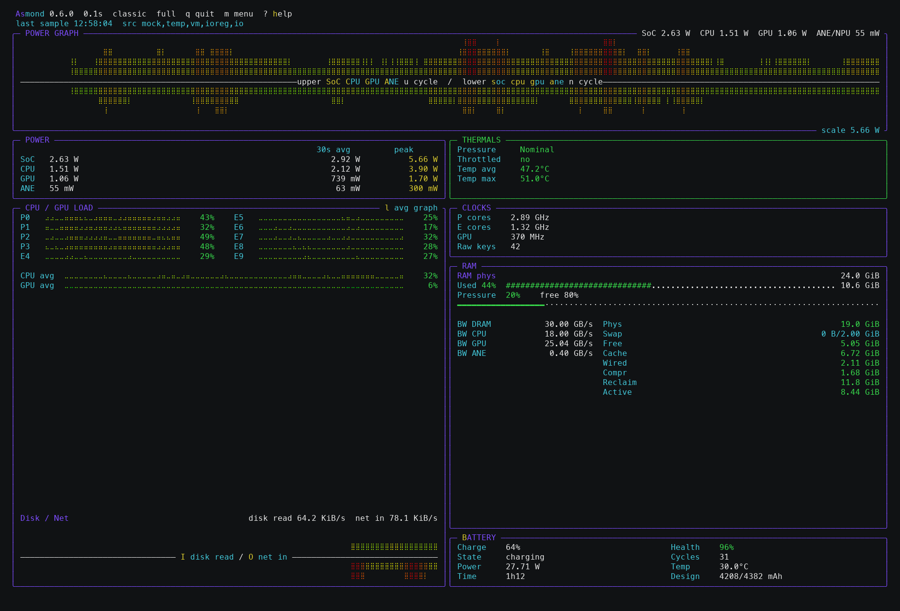
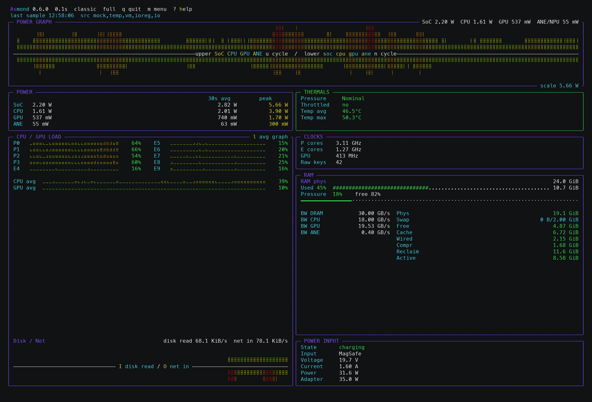
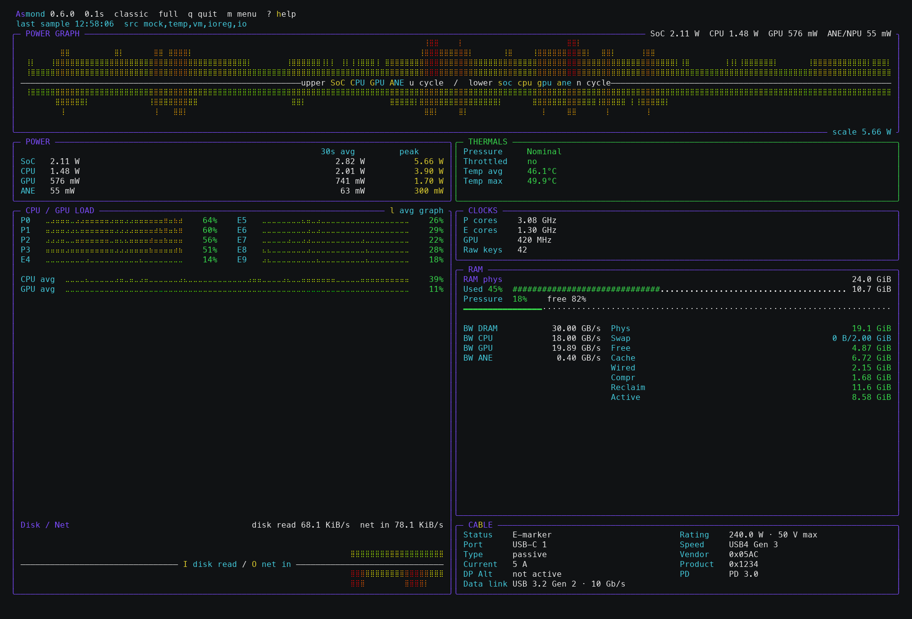
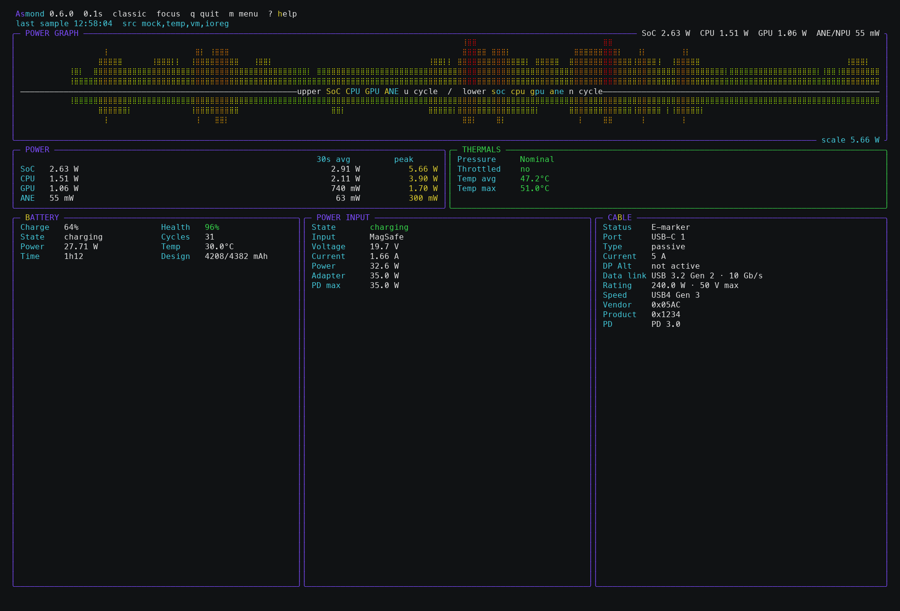

# Asmond

Current release: 0.9.1.

Asmond is a macOS power, thermal and activity monitor focused on Apple Silicon, with early experimental Intel Mac support.

It reads Apple's `powermetrics` plist stream and combines it with macOS system counters for memory, swap, battery, disk, network and process data. The project is intentionally small: a compact Python runtime, focused regression tests, and no third-party Python package dependencies.

## Preview



*Full layout with generated mock telemetry. The irregular workload history is illustrative; the displayed UI and available panels are from Asmond 0.6.0.*

<details>
<summary>Full layout with Power Input</summary>



</details>

<details>
<summary>Full layout with Cable details</summary>



</details>



*Focus layout showing the Battery, Power Input and Cable views together.*

## Features

- SoC or Intel package, CPU, GPU and ANE/NPU power where `powermetrics` exposes it
- Shared-scale split power graph with independently selectable upper and lower sources and an 11-step green-to-red terminal gradient where supported
- Current, 30 second average and peak values for power readings, followed by verified CPU/GPU average temperatures where available
- Thermal pressure, throttling state, hottest verified sensor with source, and additional physical sensor temperatures where available
- P-core/E-core usage rows, CPU/GPU average rows and an alternate CPU/GPU graph view
- P-core/E-core and GPU clocks, with live smoothing for idle `0 Hz` cluster samples
- RAM, swap and memory pressure using `vm_stat`, `vm.swapusage` and `memory_pressure`
- Legacy memory bandwidth counters in the RAM panel when `powermetrics` exposes `bandwidth_counters`
- Battery details in a compact two-column view: charge, state, health, capacity, cycle count, power, temperature and time remaining
- Power-input details from IOKit: USB-C/MagSafe active port, negotiated voltage/current/power and PD profiles when exposed
- Dependency-free USB-C cable view from real SOP'/SOP'' E-marker VDOs: type, current/voltage/power rating, data class, VID/PID and PD revision, plus the current data link and DP Alt Mode state from the matching port
- Optional compact disk/network I/O graph with selectable read/write sources
- Optional process panel with PID, CPU%, RAM%, RSS, and GPU% when macOS exposes a usable counter
- Layout presets: `full`, `compact`, `focus`, plus named custom profiles with selectable grids and independent panel assignments
- Alerts for throttling, high temperature, swap usage and battery drain
- Optional rounded Unicode panel borders, with square curses borders when disabled or unsupported
- Theme-colored ASCII logo on the waiting screen, help overlay and settings menu
- Local persistence for theme, interval, layout, custom slots, graph sources, process panel and alert thresholds
- `doctor` and anonymized `report` commands for troubleshooting
- Read-only measurement/source inspector in the settings menu, using existing worker data without extra probes

## Requirements

- macOS; Apple Silicon is the primary supported target, Intel Macs are experimental
- Python 3.10 or newer
- `sudo` access only for live `powermetrics` telemetry

Intel Macs are experimental. Asmond can read a smaller set of Intel `powermetrics` counters on tested hardware, but Apple Silicon remains the primary supported target.

`requirements.txt` is intentionally empty of package requirements.

The live dashboard, `probe`, and `report --live` use `sudo` only to start Apple's `powermetrics`. The Asmond UI remains unprivileged. Generated mock data, `doctor`, and the default non-live `report` do not require `sudo`; `doctor --live` only uses an already cached credential and never prompts for a password.

## Installation

With Homebrew:

```bash
brew tap Fxxrz/asmond
brew install asmond
```

Update an existing Homebrew installation:

```bash
brew update
brew upgrade asmond
```

Run Asmond:

```bash
asmond
```

Or run directly from a source checkout:

```bash
git clone https://github.com/Fxxrz/asmond.git
cd asmond
python3 asmond.py
```

Asmond keeps the terminal UI unprivileged and starts only `powermetrics` with `sudo`. Trusted macOS tools are invoked through fixed system paths rather than the user's `PATH`.
Homebrew also installs the manual page, available as `man asmond`.

### Direct installer

A Homebrew-independent installer is available in `install.sh`. It detects macOS and native Intel/Apple Silicon, uses an existing Python 3.10+ with `ctypes` and `curses`, and can offer the signed, prebuilt Python.org installer if Python is missing. It never compiles Python or Asmond and never runs the whole installer as root.

The default locations are `~/.local/share/asmond` for versioned files and `~/.local/bin/asmond` for the start command; custom paths are supported. PATH setup is opt-in and may require opening a new login terminal. Homebrew's Cellar and existing foreign commands are not overwritten. Direct installs support `asmond --update`; Homebrew installs must continue using `brew upgrade asmond`.

Run the installer from the pinned release tag:

```sh
curl --fail --silent --show-error --location --proto '=https' --proto-redir '=https' \
  https://raw.githubusercontent.com/Fxxrz/asmond/v0.9.1/install.sh | /bin/bash
```

Download and inspect the script before running it if preferred. The installer verifies the official release archive and checksum before activation. See [Direct installation](docs/direct-install.md) for custom paths, updates and rollback. Direct-install assets are available starting with 0.9.0; use 0.9.1 or later for working interactive confirmations. Older releases are not substituted with unchecked source downloads.

## Usage

The examples below use the installed `asmond` command. From a source checkout, replace `asmond` with `python3 asmond.py`.

Run the dashboard:

```bash
asmond
```

Run with generated demo data:

```bash
asmond --mock
```

Show one parsed sample:

```bash
asmond probe
```

Inspect raw flattened `powermetrics` keys and values:

```bash
asmond probe --raw
```

`probe --raw` is not anonymized. Prefer `asmond report` for public bug reports.

Check local data sources without starting the TUI:

```bash
asmond doctor
asmond doctor --json
asmond doctor --live
```

`doctor --live` checks one real sample only when the current `sudo` credential is already cached; it does not prompt.

Create an anonymized support report:

```bash
asmond report
asmond report --json
asmond report --live
```

Show the installed version:

```bash
asmond --version
```

Optional local recording:

Asmond supports explicit [local recording](docs/recording.md), without changing the dashboard:

```sh
asmond record --interval 10
# Without powermetrics/sudo:
asmond record --groups cpu,memory,processes,io --interval 2
asmond export "/path/to/asmond-record-session" --output-dir "$HOME/Desktop/Asmond-CSV"
```

Recording creates a private session under `~/Library/Logs/Asmond`, daily UTC JSONL files and a default **256 MiB total limit** that stops without deleting old files. Ctrl+C stops; `--duration` optionally limits the run. `--groups` selects CPU, power, temperatures, memory, processes, I/O and battery. Only the power group requests sudo for powermetrics; the recorder stays unprivileged. No daemon, automatic restart, process action, cloud or extra runtime dependency is added. Independent process CPU/RSS top tens and real swap/compressor counter deltas distinguish activity from occupancy. Missing/reset/gapped reads do not become fake zero rates. CSV export creates separate metrics, process and event tables. Logs are sensitive local data, not anonymized support reports.

Print the settings path:

```bash
asmond --config-path
```

Useful options:

```bash
asmond -i 0.2 --history 240 --theme nord
asmond --theme dracula --layout compact --show-io
```

Run tests:

```bash
python3 -m unittest -v
```

Measure test coverage:

```bash
python3 -m pip install -r requirements-dev.txt
python3 -m coverage run -m unittest
python3 -m coverage report
```

Preview the manual page from a checkout:

```bash
man ./man/asmond.1
```

## Controls

```text
q       quit
? / h   toggle help overlay
m       toggle settings menu
t       cycle theme
T       open Tailor: profiles, grids and panel assignments
+/-     change and apply sample interval, down to 0.1s
r       reset power graph history and peaks
v       cycle layout preset: full, compact, focus, custom
d       show or hide Disk/Network I/O panel
i       cycle the upper Disk/Network graph source
o       cycle the lower Disk/Network graph source
L       toggle CPU/GPU average view
b       cycle charge panel: Battery, Power Input, Cable, optional Port diagnostics
S/C/G/A select SoC/package, CPU, GPU or ANE/NPU for the upper power graph
s/c/g/a select SoC/package, CPU, GPU or ANE/NPU for the lower power graph
u       cycle the upper power graph
n       cycle the lower power graph
p       cycle process panel: hidden, left, right
up/down select process
left/right switch connected Cable ports when visible; otherwise change process sort
k       mark selected process, press k again to send TERM
```

In the settings menu, use Up/Down or Tab to move, Left/Right or Enter to change a value, `s` to save and Esc to close.

**Rounded borders** switches all dashboard and overlay boxes between rounded Unicode corners and square curses borders, useful for terminal fonts that draw rounded corners poorly. **Port diag in b** includes or skips Port diagnostics in the charge-panel cycle and its next-view hint; off leaves Battery → Power Input → Cable → Battery. Both preferences are saved automatically and default to on to preserve existing behavior. Diagnostics remain directly accessible through **Port diagnostics** in the menu and as an independent Tailor block. Turning the cycle option off while diagnostics is active returns to the previous charge view; a later restart with a saved diagnostics selection starts on Battery while the option is off. Neither setting disables telemetry or reported-liquid warnings.

Up/Down wraps from the first entry to the last and back in the settings menu, Tailor, Data sources and the process list. Moving the process selection always cancels a pending TERM confirmation.

Press `T` from any dashboard layout to open the Tailor menu directly and switch to `custom`. Up/Down selects a menu row, Left/Right changes its value, and Enter applies an action. Esc or `T` closes the menu. There is no extra grid/slot selector or `g` shortcut. Numbers `1`–`7` select an existing field of the active grid directly and focus its panel row; the **Field** menu row remains available for arrow-only navigation.

The **Profile** row switches between named configurations and shows the current index/count. Initially there is only one profile, **Default (1/1)**; choose **Duplicate profile** to create an independent copy, then **Rename profile** to name it. **Delete profile** removes the selected profile only after confirmation and switches to another existing profile; the last remaining profile is protected. Up to 16 profiles can be stored, including multiple configurations of the same grid. Each profile remembers its selected grid, graph visibility and separate assignments for Classic, Balanced and Columns. Existing custom settings become the first profile without losing their assignments; the legacy Classic settings remain readable by older Asmond versions.

Use **Layout grid** to select **Classic** (the original full grid, seven editable fields), **Balanced** (2×2, four fields), or **Columns** (3×2, six fields). Columns uses 2×3 below 144 terminal columns without changing the assignments. **Power graph** shows or hides the wide graph for this profile. Hiding it returns the entire top area to the fields below; built-in Full, Compact and Focus are unchanged. **Field**, **Custom panel** and **Custom detail** edit the selected area; the menu shows its size and warns when content needs more room. Fixed detail levels are labelled accordingly.

**Swap with field** exchanges two panel/detail assignments. **Copy to field** copies the selected field to a target chosen with Left/Right; Enter asks for confirmation before overwriting it. **Reset grid** restores only the active profile's current grid, also with confirmation. Esc cancels either confirmation. Other profiles and grids are unchanged, and edits are saved automatically.

For a read-only measurement inspector, open `m`, select **Data sources** and press Enter. Up/Down scrolls the received values and their source descriptions; Esc returns to the menu. The inspector uses existing worker data and never starts extra probes or requests additional privileges. It distinguishes generated mock data, derived/fallback values and unavailable readings. Recorded temperature-reader metadata is shown as a group, not invented per-sensor provenance; `n/a` does not prove that hardware lacks a capability. Per-field freshness/read status is not available for every model field, so the inspector does not replace hardware validation. On the M2 Max 8P+4E, explicitly unassigned `SMC <key>` readings are available for comparison, including zero/sentinel-like values; they do not contribute to CPU/GPU averages, hotspot selection or alerts. The same raw-key values are included in `probe` and the live report.

Battery, Power Input, Cable and Port diagnostics are available as independent blocks. These fixed blocks keep their selected source and show an unavailable message if the hardware exposes no telemetry. The existing `Charge (switchable)` block still follows `b` and its capability-aware fallback. Existing saved custom layouts keep their assignments. A Battery block in the lower-right charge slot uses six lines, leaving the recovered space for the panel above.

When Cable is visible with multiple connected, uniquely identified ports, Left/Right cycles those ports and wraps; its Port row shows the current selection and count. Data-only connections remain selectable even when no E-marker is exposed. The session-only selection follows the physical port across registry reordering, not a device name or list position; unplugging it restores automatic selection of a remaining connection. This also works for fixed Tailor Cable fields and the simultaneously visible Cable panel in wide Focus. Menus, help, Tailor and active Port diagnostics keep keyboard priority. While Left/Right belongs to Cable it does not also change process sorting; Up/Down process selection remains available, and **Process sort** in `m` remains usable. Switching Cable ports cancels a pending TERM confirmation. With no multi-port Cable view visible, process sort arrows retain their existing order: PID, CPU, GPU (when shown), RAM, RSS, command.

For port diagnostics, select the fourth charge-panel view with `b`, or open **Port diagnostics** in the regular `m` menu. It opens directly in the normal Cable/Power Input box, capped at eight terminal rows; no Enter step or popup is needed. The selected port appears once in the header, with only a few values shown at a time. Left/Right selects a port or explicitly unmapped controller, Up/Down scrolls all values and wraps, `b` continues to Battery, and Esc restores the previous charge view. `q` quits directly. Other dashboard panels remain visible and keep polling where they fit. A visible process table has no selection cursor or action hints while diagnostics owns the arrows; process sorting, `p` and TERM actions are disabled, and pending TERM confirmations are discarded. Menus/help/Tailor take keyboard priority and return focus on close. Saved Tailor assignments are never overwritten; where there is no charge slot, diagnostics temporarily uses a suitable existing field rather than opening a full-width lower page. Fixed Tailor diagnosis blocks remain compact summaries outside the active diagnostics mode.

Switchable charge panels show a separate right-aligned navigation hint such as `b › Cable`, indicating the next selection without depending on a B in the title; narrow panels shorten it to `b ›`. Fixed Tailor blocks intentionally have no cycling hint. Liquid detection shows only the reported HPM controller state; “not reported” is not a guarantee that the port is dry or undamaged. A positive report is also visible in the dashboard status line regardless of the selected panel. The port-diagnosis panel hides missing fields, blank status text and all-zero raw event-buffer sections, and automatically shows them when data arrives. Real zero counters and explicit false/disconnected states remain visible. Unknown controller identity remains labelled in the header; absent data never becomes a healthy-port verdict. Without any readings the panel simply waits for data. The source inspector and other dashboard panels keep their existing missing-value behavior.

Port counters are reported events, not a wear percentage or proof of a defective cable. Controller entries lacking an unambiguous explicit port identity are labelled `Controller N (port unknown)`; Asmond never assigns these diagnostics by array position. Only mapped sources receive bounded, session-only observation logs and counter increments; counter decreases establish a new baseline rather than becoming negative errors. Timestamps identify when Asmond observed a change, not its precise hardware time. Polling can miss transitions and the underlying counters can reset or be batched. Firmware PD event buffers are available as bounded raw hex only: undocumented event codes are not speculatively decoded.

The settings menu's **Graph view** switches the existing wide graph between `power` and `charging`, without adding a permanent dashboard block or a new hotkey. The charging graph uses only reported `SystemPowerIn` input telemetry and signed battery power (`+` charging, `-` discharge), never the charger rating or negotiated PD maximum. Input is green and battery power uses the accent color; overlapping cells are neutral. Samples use their actual receive-time positions, genuine zero readings remain zero, and missing readings remain gaps. The header hides stale readings and reports their age. Load changes, charge optimisation and macOS limits can change the curve; it is not a cable-fault verdict. History is session-only and `r` clears it with the other power history.

Selected power-graph source names use the theme's green or magenta role for the whole name, including its shortcut letter. Unselected names retain their yellow shortcut letters. Solar selects green; monochrome terminals use bold/underline instead. Existing terminal palette entries are not modified.

The `focus` layout is the combined power/thermal view. Older saved settings named `power-only` or `thermals-only` are mapped to `focus` automatically.

The `compact` layout uses a short, visible Power Graph above a five-line Power/Thermals row. It keeps the lower panels' existing space instead of reserving an empty graph area.

Process termination uses the current user's permissions. The full TUI refuses root launches by default; use normal `asmond` so only `powermetrics` receives elevated privileges. Root UI mode exists only as an explicit override with `--allow-root-ui`, and root process termination remains disabled unless enabled again for that session. A root process does not write settings, so neither that permission nor other root-session changes are persisted.

Asmond refreshes the existing `sudo` timestamp while live telemetry is running. It deliberately does not call `sudo -k` on exit because doing so could revoke a credential that existed before Asmond started.

Settings are saved in:

```text
~/Library/Application Support/Asmond/settings.json
```

If Asmond is explicitly launched via `sudo` for a non-dashboard command, the settings path is resolved through `SUDO_USER` so the file still belongs to the real user.

Command-line help shows the currently saved defaults for options such as interval, theme and layout.

Remove saved settings:

```bash
asmond --remove-settings
```

Homebrew does not remove per-user settings automatically on uninstall. To remove everything:

```bash
asmond --remove-settings
brew uninstall asmond
```

## Themes

Available themes:

```text
classic matrix solar mono nord dracula ocean ember
```

## Data Accuracy

Asmond prefers exposed macOS counters over estimates. Some values are not publicly available on every system. ANE/NPU frequency is hidden because there is no reliable public counter, and ANE/NPU usage is shown only when `powermetrics` exposes a real active-residency counter; ANE power is never converted into an estimated percentage. Media Engine counters are kept as best-effort diagnostic data and appear in probe output only when the local `powermetrics` output contains usable fields.

Values explicitly marked invalid by `powermetrics`, negative sentinel values and non-finite numbers are treated as unavailable. If the main stream exits or stops producing fresh data, the dashboard marks the sample stale and retries the sampler with bounded backoff.

Expired stream values and their active temperature/throttle alerts become
unavailable until a fresh sample arrives; historical graph points and peaks
remain history. Supplementary sensor-cache entries also have a freshness limit
if a native refresh stalls.

The native plist's `processor.combined_power` is interpreted as milliwatts,
including readings below 100 mW. Its magnitude never switches the unit to watts;
explicit unit strings are converted separately. Component energy counters use
the actual elapsed sampling time, while an already averaged power is not divided
by that interval again.

Graph colors use an 11-step green-to-yellow-to-red palette when the terminal exposes at least 256 colors. Terminals with fewer colors automatically retain the existing green/yellow/red thresholds, while the intentionally monochrome `mono` theme remains monochrome on every terminal. Power and I/O graph colors describe a sample's position relative to the graph's current scale; red therefore means near that displayed scale maximum, not necessarily a critical hardware state. The graph geometry and underlying values are unchanged.

Thermal pressure is shown exactly as macOS reports it. A `Throttled` state is set only from an explicitly active throttle, PROCHOT or Plimit signal, or from a macOS pressure state of `Serious`, `Heavy` or `Critical`. Intel `perf_limit_reasons` are displayed separately as `Perf reason` because `powermetrics` does not identify those strings as current versus latched state; normal turbo-control reasons can also appear while thermal pressure is `Nominal`. Asmond therefore preserves those reported reasons without turning them into an inferred thermal-throttling state.

On the base Apple M4 with four performance and six efficiency cores, CPU and GPU temperature averages/maxima come from read-only AppleSMC sensor groups verified against per-core readings and separate CPU/Metal load tests. Their averages appear beside CPU/GPU power; SoC and ANE rows remain `n/a` because no verified temperature mapping is assigned to them. When a CPU core is the hottest verified sensor, the Thermals panel identifies its zero-based efficiency/performance core, for example `44.0°C · CPU@E5`; narrow panels shorten that source to `E5` rather than clipping it. On the tested machine the panel can additionally show the real Power Manager Die average plus AppleSMC power-supply, Wi-Fi/AirPort, trackpad and trackpad-actuator sensors. These are kept separate rather than being relabelled as CPU or SoC temperatures.

On the tested **Mac14,5 / M2 Max / 8P+4E**, AirPort, trackpad and trackpad-actuator temperatures now use their independently compared AppleSMC keys. This narrow auxiliary map does not enable CPU/GPU/core or power-supply-temperature assignments, and is not extrapolated to other M2 chassis. Mapped auxiliary values appear in the normal named fields rather than also being labelled unassigned raw readings. `TCMb` is not used as a CPU average on either model: M4 averages the verified individual keys; M2 Max retains `TCMb`/`TCMz` only as unassigned comparison data. For a time-aligned M2 comparison without extra packages, sudo or automatic workloads, see [the comparison guide](docs/m2-max-comparison.md).

If one CPU SMC key is temporarily unavailable, Asmond does not publish an incomplete CPU average. Independently valid GPU and auxiliary SMC values still contribute to the real maximum and alerts, however. Every effective maximum carries its concrete source (`CPU@…`, `GPU`, `PMU`, `IOHID`, `powermetrics` or a named auxiliary sensor), while the overall source records combinations such as `AppleSMC + IOHID`. The TUI hotspot, alert threshold, `probe` output and JSON report therefore use the same maximum during a partial sensor read. Once the complete verified CPU SMC group is available, its physical sensor set is authoritative and an unlabelled generic fallback does not silently replace it.

The lower `PMU tdie` readings exposed through IOHID are power-manager-die sensors, not CPU-core temperatures. The tested M4 exposes neither a named `SOC MTR Temp Sensor` nor a named `ANE MTR Temp Sensor` through IOHID. The available `TCMz` SMC value tracks CPU-die maximum and is therefore not relabelled as SoC temperature; low-confidence shared ANE candidates are also rejected. Other Apple Silicon variants keep their existing named IOHID fallback until their SMC key groups are validated; Asmond does not extrapolate an M4 mapping to a different SoC or core topology. Reading AppleSMC does not require `sudo` and adds no package dependency. At dashboard intervals below 0.75 seconds, the most recent real SMC/IOHID read is reused until the next 0.75-second sensor refresh so a slow hardware read cannot block the faster `powermetrics` pipe; values are never interpolated or estimated.

Battery health uses the nominal/full and design capacities exposed by `AppleSmartBattery`, including the nested `BatteryData` fields used by newer macOS versions. Battery temperature continues to prefer the existing `AppleSmartBattery` temperature fields and falls back to Apple's IOHID gas-gauge battery sensors when those fields are absent.

In the full dashboard, the four-row Battery view uses a six-line panel including its border and gives the two saved lines to RAM. Power Input, Cable and Port diagnostics retain an eight-line panel because they have additional fields. Press `b` to cycle these views, skipping diagnostics when **Port diag in b** is off; switching recalculates the layout immediately, including capability fallback when a source is unavailable. `Power Input` is deliberately generic: its `Input` row identifies USB-C or MagSafe when the port source proves it, otherwise adapter-only input is labelled `AC Input`. Adapter voltage/current alone never establish the connector type.

On legacy Intel batteries, Apple's exposed full-charge capacity can move with battery state and load, so the displayed health percentage can move with it. Asmond reports that current capacity estimate and deliberately does not substitute the separate diagnostic `Qmax` value.

Apple Silicon is the stable primary platform. Intel Mac support remains experimental and intentionally conservative until it has been exercised across more machines and macOS versions. On the tested Intel Mac mini and MacBook Air hardware, Asmond can read package/CPU/iGPU power, CPU/GPU load, clocks, RAM, swap, disk/network I/O and process data. Intel package power is labelled `Package` rather than `SoC`, and `probe` uses the same Mach CPU-load source as the dashboard and live report. The MacBook Air path also reads CPU-die temperature, fan speed, battery capacity and legacy MagSafe adapter telemetry when `powermetrics` and IOKit expose them. SMC data can be temporarily unavailable on some samples; unsupported counters stay hidden or show `n/a` rather than estimated values.

Per-process GPU% is a legacy, best-effort path. `powermetrics --show-process-gpu` documents per-process GPU time, but Apple notes that it is only available on certain hardware. Current tested Apple Silicon/macOS builds either omit the counter from plist output or report only zeroes in text output; in that case Asmond hides the GPU% process column instead of showing misleading 0.0% values.

Memory bandwidth support is a legacy, best-effort path. Older macOS/Apple Silicon combinations exposed `bandwidth_counters` in the `powermetrics` plist stream, but this appears to be unavailable on current macOS releases and is not covered by the maintainer's current hardware tests. When the counters are present, values are grouped by visible names such as CPU, GPU, ANE, DRAM or DCS and displayed as GB/s; otherwise the bandwidth rows stay hidden.

Power-input information is decoded from the AppleSmartBattery and AppleHPMInterface IOKit trees, falling back to AppleTCController when the primary port class is empty, as on the tested M2 Max. The sources are not merged or assigned by enumeration order. It supports USB-C PD, MagSafe and legacy Intel MagSafe adapter telemetry when exposed. Live voltage, current and wattage prefer measured telemetry and fall back to negotiated adapter/PD values; fixed, battery, variable and PPS request objects are decoded only with their matching USB-PD field layout. A physical `ConnectionActive` port is correlated with the global input state and per-port contract/FED evidence. `ConnectionActive` alone proves only a cable or data connection and never turns that port into a power sink. This separation also avoids trusting battery-controller contract fields that can remain stale briefly after unplugging or moving a charger.

Controller contracts and FED entries join physical ports only through unique,
explicit matching identities. A controller array position or `BestAdapterIndex`
does not identify a connector. Unmapped contract snapshots retain a neutral
`port unknown` label; global measured input remains available as `AC Input`
when macOS confirms power but does not identify the physical connector.

On Apple Silicon and native Intel Macs, available fans are read directly through the read-only AppleSMC `FNum` and `F#Ac` actual-RPM keys. Each reported fan retains its numeric hardware index, including genuine 0 rpm; target/minimum/maximum speeds are not substituted, actual readings are not clamped to firmware limits, and no left/right assignment is inferred. Detailed `fan_rpms` are separate from the legacy scalar `fan` field in reports; powermetrics remains the scalar fallback when indexed readings are unavailable. The Intel path is verified against a two-fan MacBookPro14,3 capture; Intel support remains experimental.

Some Intel powermetrics samples expose package power without separate CPU/iGPU watts. Those component fields remain unavailable; SMC temperature targets such as `cpu_die_power_target` are never treated as measured power. M2 Max CPU/GPU/core temperature assignments remain unverified: raw comparison keys do not become named core temperatures or contribute to averages, hotspots or alerts.

Cable information is separate from the negotiated input contract. On Apple Silicon, Asmond reads the public `IOPortTransportComponentCCUSBPDSOPp` and `...SOPpp` IOKit services and decodes only a connected cable's own E-marker VDOs. The relatively static identity is refreshed on connection/port changes and every five seconds while connected; live charge and transport state keeps its faster polling interval. Asmond never infers a 3 A/5 A rating from the current charging draw, and lingering controller data from a disconnected port is not presented as the current cable. If macOS does not publish an E-marker response, the panel says `no E-marker data`; this does not claim that the physical cable lacks a marker. Vendor and product IDs stay numeric because Asmond does not bundle a vendor database. `Data link` and `DP Alt` are deliberately live connection states from the matching `AppleHPMInterface.TransportsActive` list. For a direct USB connection, Asmond correlates the XHCI port's `UsbIOPort` path and exact `locationID` with the directly attached `IOUSBHostDevice`, then uses its reported `UsbLinkSpeed`; for example, a real 10 Gb/s link is shown as `USB 3.2 Gen 2 · 10 Gb/s`. Ambiguous or missing topology data falls back to Apple's broader `USB2`/`USB3` transport name instead of guessing. `DP Alt: active` confirms that DisplayPort is being carried now; `not active` does not claim the cable is incapable of DisplayPort. The Mac port's generic `TransportsSupported` list is not presented as a cable feature. Intel port controllers do not expose this public cable-identity path on the tested machines, so the Cable view falls back to the available Power Input or Battery view there.

RAM labels are macOS-specific: `Used` is active plus wired memory, while `Phys` is physical occupancy (`total - free/speculative`). `Pressure` uses Apple's `memory_pressure` command when available and otherwise falls back to a reclaimable-memory estimate.

For bug reports, include `asmond doctor` and, if comfortable, `asmond report`. Use `asmond report --live` only when a live `powermetrics` snapshot is relevant.

Security issues should be reported privately as described in [SECURITY.md](SECURITY.md). Do not attach raw `probe --raw` output to a public issue without reviewing it first.

## Intel validation capture

For an installed Homebrew Asmond, the single-file `tools/collect-apple-silicon-research.py` also supports native Intel via `--intel` (the historical filename is retained). It includes read-only indexed SMC temperature/fan discovery and individual actual/target/limit values, even when the current Asmond UI has only one scalar fan reading:

```bash
python3.14 tools/collect-apple-silicon-research.py --intel intel-idle ~/Desktop
```

For a Git checkout instead of an installed Asmond command, add `--source-dir ~/asmond` (or the actual checkout directory). The collector uses its own Python interpreter for both the selected source's reports and native sensor worker, so no Homebrew Asmond formula is required. The directory must contain `asmond.py` and `asmond_smc.py`; use a native Python 3.10 or newer that can run that checkout.

Run as a normal user; only powermetrics is elevated. If possible, repeat during ordinary workload with `intel-workload` and include nearby Macs Fan Control screenshots. This collector needs no development checkout on the target when the one script is copied there, adds no dependencies, and does not control fans, change settings or create artificial load. Review archives before sharing. The older shell collector below additionally provides an automated TUI soak.

`tools/collect-intel-mac-research.sh` creates an anonymized validation bundle from a native Intel Mac. Run it as a normal user; only `powermetrics` is elevated. The collector removes its raw temporary files, redacts hardware/user identifiers and real process identities, and writes a SHA-256 sidecar next to the archive.

Capture at least one settled charging and battery state:

```bash
tools/collect-intel-mac-research.sh charging ~/Desktop
# Unplug the charger, wait about 30 seconds, then run:
tools/collect-intel-mac-research.sh battery ~/Desktop
```

If time permits, repeat with labels such as `charging-load`, `battery-load`, and `reconnected` while the named condition is actually active. Those optional bundles help validate frequency, temperature, fan and charger-transition behavior. `ASMOND_SKIP_SUDO=1` makes a partial non-privileged capture, `ASMOND_SKIP_TUI=1` skips the automated dashboard smoke test, `ASMOND_SAMPLE_COUNT=1..10` controls the number of main `powermetrics` samples, and `ASMOND_TUI_SECONDS=1..7200` changes the automated dashboard duration from its eight-second default. A 60-minute soak uses `ASMOND_TUI_SECONDS=3600`; the status file records elapsed time, terminal activity in 60-second windows, maximum output silence, sampler restarts, stale-stream warnings, sudo-refresh failures and tracebacks before the harness sends `q`. Complete `last sample` timestamps are retained when curses emits them, but are informational because later redraws may update only individual characters. Review the resulting `.tgz` before sharing it, even though the collector is designed to exclude settings, serials, UUIDs, network addresses and real process names.

## License

MIT
